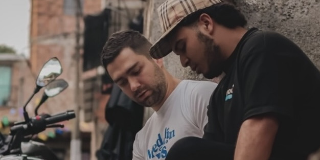
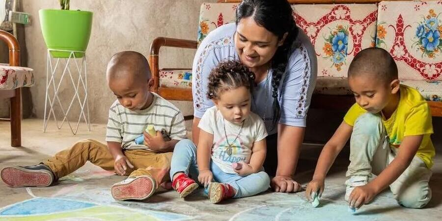

# Centro de Valor Público

The Centro de Valor Público is Universidad EAFIT's applied policy research center. It designs and evaluates public programs with governments, international organizations and firms. Its work falls into five initiatives: security and justice, government and democracy, economic development, social innovation, and equity and social development. I have directed the Centro since 2025. Its publications, policy notes and team are listed on the [Centro's page at EAFIT](https://www.eafit.edu.co/centros-estudio-incidencia/valor-publico).

---

## Parceros Creadores

**Partner:** Secretaría de Juventud de Medellín

Every year, thousands of young people in Medellín leave school without finding stable work. Some of them face a high risk of recruitment by criminal groups. Parceros Creadores uses a screening survey to find youth who are neither studying nor working and who are at risk. Those it finds receive psychological and vocational support.

The Secretaría runs the program as a sequence of experiments. Each cohort answers one design question, which then shapes the following year's program. In 2024 we randomly assigned about 1,500 youth to cognitive behavioral therapy (CBT), delivered in group or individual sessions, or to an experiential coaching program, a comparison in which CBT produced the largest reductions in depression and anxiety and the largest gains in interest in work and study. The 2025 experiment, with 4,000 youth (half of them treated), compared group with individual CBT and varied the number of sessions to find the dose with the largest effect for its cost, which turned out to be thirteen individual sessions. In 2026 the program treated roughly 1,400 youth with that protocol and added a harm-reduction component on drug use.

---

## Sistema del Cuidado de Antioquia

**Partner:** Gobernación de Antioquia

In Antioquia, women spend up to 14 hours a day on unpaid care work. In 65 percent of households they carry it alone. Those hours cannot go to paid work, which keeps women's labor force participation and income low. The Gobernación's care system works on four fronts: care centers and community spaces, training for care workers, cultural programs (including work with men on sharing care) and coordination across government agencies. If it works as designed, the hours it frees should first show up as more women in paid jobs and, later, as a more even division of care within households.

---

## Municipal strengthening along the OCENSA pipeline

**Partner:** OCENSA (Oleoducto Central S.A.)

Forty-nine municipalities sit along the route of Colombia's central oil pipeline. Most have small technical staffs. They have trouble formulating projects that qualify for national funding or planning the use of their territory. Besides training municipal officials in project formulation for public financing mechanisms, territorial planning and fiscal management, the Centro set up participatory planning and accountability routines that give the company and the municipalities a regular channel for dialogue.

---

## Hogares Saludables

**Partner:** Cementos Argos

Hogares Saludables, run by Cementos Argos, improves floors, bathrooms and kitchens in low-income homes. Families take part in every stage, including construction. The program has improved more than 10,000 homes and reached 25,000 people in Colombia. Replications are running in the Dominican Republic, Puerto Rico, Honduras and Panama. Participating families report that their children fall sick less often, that adults sleep better and that they now invite people into homes they used to avoid showing.

---

## Work with us

The Centro takes on research, policy design and evaluation projects with governments, multilateral organizations, NGOs and private firms. For inquiries, write to [stobonz@eafit.edu.co](mailto:stobonz@eafit.edu.co) or visit the [Centro at EAFIT](https://www.eafit.edu.co/centros-estudio-incidencia/valor-publico).
