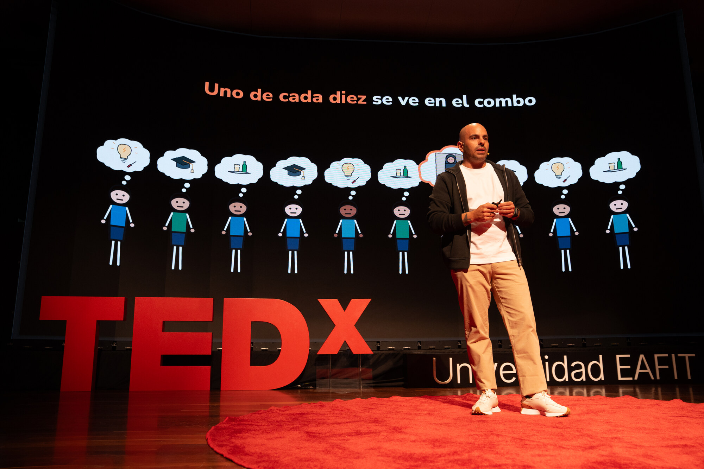

<section class="hero">

<h1>Santiago Tobón</h1>

Estudio cómo opera el crimen organizado, cómo los grupos criminales gobiernan comunidades y extraen recursos, y qué pueden hacer los gobiernos al respecto. La mayor parte de mi trabajo de campo se desarrolla en ciudades colombianas, donde hago experimentos y recojo datos originales.

Profesor de Economía, Universidad EAFIT · Director, <a href="centro/">Centro de Valor Público</a> · Presidente, AL&nbsp;CAPONE

<a href="../cv/cv_santiago_tobon.pdf">CV (PDF)</a><a href="https://scholar.google.com.co/citations?user=lLZedAMAAAAJ&amp;hl=es">Google Scholar</a><a href="https://ideas.repec.org/f/pto355.html">IDEAS/RePEc</a><a href="mailto:stobonz@eafit.edu.co">Correo</a><a href="https://twitter.com/santiagotobon">X</a>

<figure>

<figcaption>TEDxUniversidad EAFIT, octubre de 2026</figcaption>
</figure>
</section>

<section class="latest" aria-label="Reciente">

Reciente

<ul>
<li>nov. 2026<a href="research/publications/#journal-articles">Organized Crime and Violence</a>, aceptado en el <em>Annual Review of Economics</em></li>
<li>nov. 2026<a href="https://doi.org/10.1017/S0003055426101555">State-Building in the City</a>, publicado en el <em>American Political Science Review</em> 120(4)</li>
<li>oct. 2026<a href="https://peaceinourcities.org/resources/compendium-urban-violence-prevention/">Organized Crime as Urban Governance</a>, capítulo en un compendio de Peace in Our Cities</li>
</ul>
</section>

<section class="index">

<h2>Investigación</h2>

Gobernanza criminal, policía, cárceles y mercados ilícitos. Artículos en el <em>Review of Economic Studies</em>, el <em>American Political Science Review</em>, el <em>Review of Economics and Statistics</em> y el <em>Journal of the European Economic Association</em>, entre otras revistas.

<a class="more" href="research/publications/">Publicaciones y documentos de trabajo →</a>

<h2>Libro</h2>

COCAÍNA: Anatomía de un mercado prohibido

Cómo la prohibición define las reglas del negocio de la cocaína, y por qué cada ofensiva favorece a las organizaciones más capaces de ejercer violencia y comprar autoridades. Saldrá con Penguin Random House Grupo Editorial, previsto para 2027.

<a class="more" href="book/">Sobre el libro →</a>

<h2>Valor Público</h2>

El centro de investigación aplicada en política pública de EAFIT. Evaluación de programas y diseño de políticas para gobiernos, desde evaluaciones experimentales de intervenciones juveniles hasta fortalecimiento institucional en 49 municipios.

<a class="more" href="centro/">Proyectos →</a>

<h2>Escritos</h2>

Notas de política e informes, columnas en El Colombiano y La Silla Vacía, textos en VoxDev y Nada es Gratis, y cobertura de prensa de mi investigación, incluido <em>The Economist</em>.

<a class="more" href="writing/">Escritos y medios →</a>

</section>
