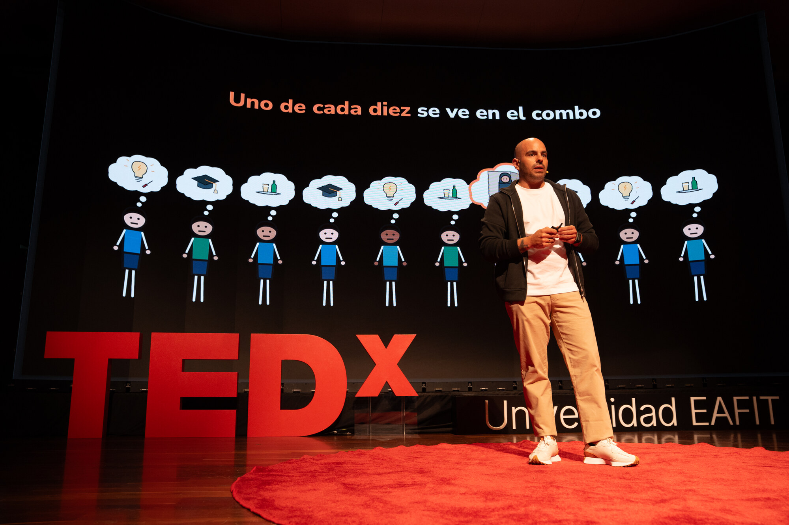

<section class="hero">

<h1>Santiago Tobón</h1>

I study how organized crime operates, how criminal groups govern communities and extract resources, and what governments can do about it. Most of my fieldwork takes place in Colombian cities, where I run experiments and collect original data.

Professor of Economics, Universidad EAFIT · Director, <a href="centro/">Centro de Valor Público</a> · Chair, AL&nbsp;CAPONE

<a href="cv/cv_santiago_tobon.pdf">CV (PDF)</a><a href="https://scholar.google.com.co/citations?user=lLZedAMAAAAJ&amp;hl=en">Google Scholar</a><a href="https://ideas.repec.org/f/pto355.html">IDEAS/RePEc</a><a href="mailto:stobonz@eafit.edu.co">Email</a><a href="https://twitter.com/santiagotobon">X</a>

<figure>

<figcaption>TEDxUniversidad EAFIT, October 2026</figcaption>
</figure>
</section>

<section class="latest" aria-label="Latest">

Latest

<ul>
<li>Nov 2026<a href="research/publications/#journal-articles">Organized Crime and Violence</a> accepted at the <em>Annual Review of Economics</em></li>
<li>Nov 2026<a href="https://doi.org/10.1017/S0003055426101555">State-Building in the City</a> in print, <em>American Political Science Review</em> 120(4)</li>
<li>Oct 2026<a href="https://peaceinourcities.org/resources/compendium-urban-violence-prevention/">Organized Crime as Urban Governance</a>, chapter in a Peace in Our Cities compendium</li>
</ul>
</section>

<section class="index">

<h2>Research</h2>

Criminal governance, policing, prisons, and illicit markets. Articles in the <em>Review of Economic Studies</em>, <em>American Political Science Review</em>, <em>Review of Economics and Statistics</em>, and <em>Journal of the European Economic Association</em>, among others.

<a class="more" href="research/publications/">Publications and working papers →</a>

<h2>Book</h2>

COCAÍNA: Anatomía de un mercado prohibido

How prohibition sets the rules of the cocaine trade, and why each crackdown favors the organizations most capable of violence and corruption. Forthcoming in Spanish from Penguin Random House Grupo Editorial, expected 2027.

<a class="more" href="book/">About the book →</a>

<h2>Valor Público</h2>

EAFIT's applied policy research center. Program evaluation and policy design for governments, from experimental evaluations of youth interventions to institutional strengthening across 49 municipalities.

<a class="more" href="centro/">Projects →</a>

<h2>Writing</h2>

Policy notes and reports, columns in El Colombiano and La Silla Vacía, pieces in VoxDev and Nada es Gratis, and press coverage of my research, including <em>The Economist</em>.

<a class="more" href="writing/">Writing and media →</a>

</section>
